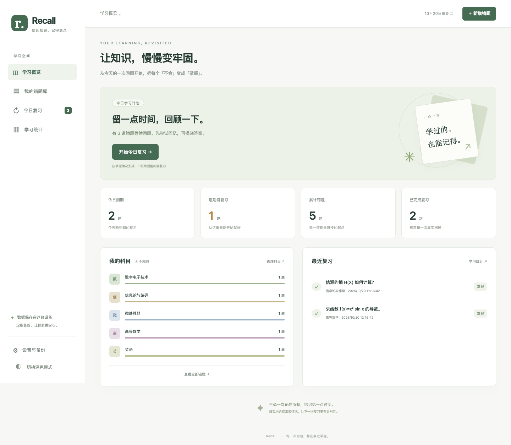
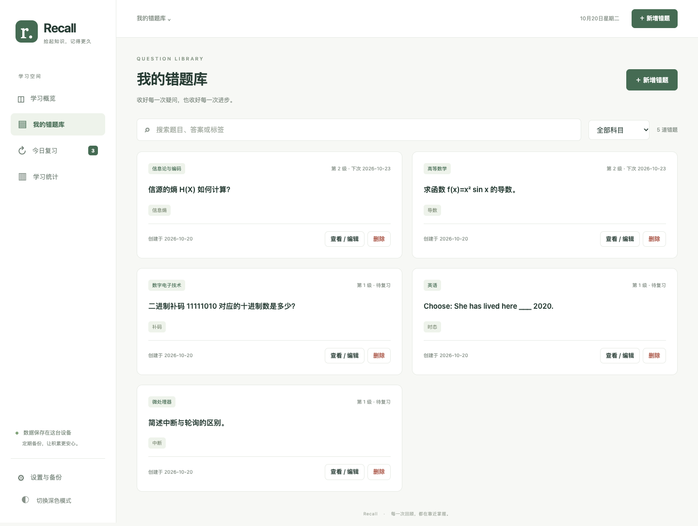
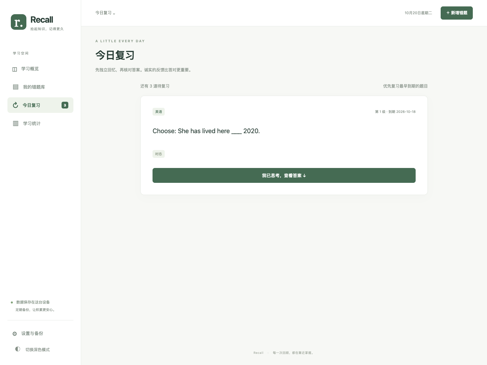
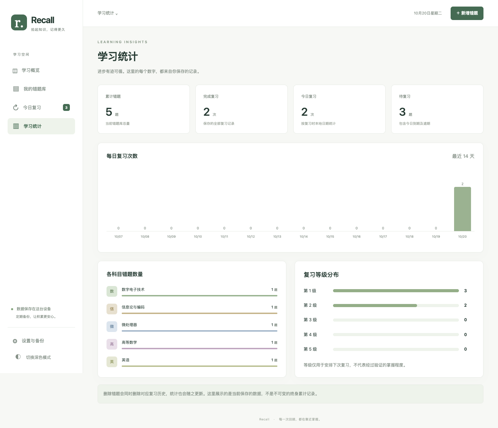
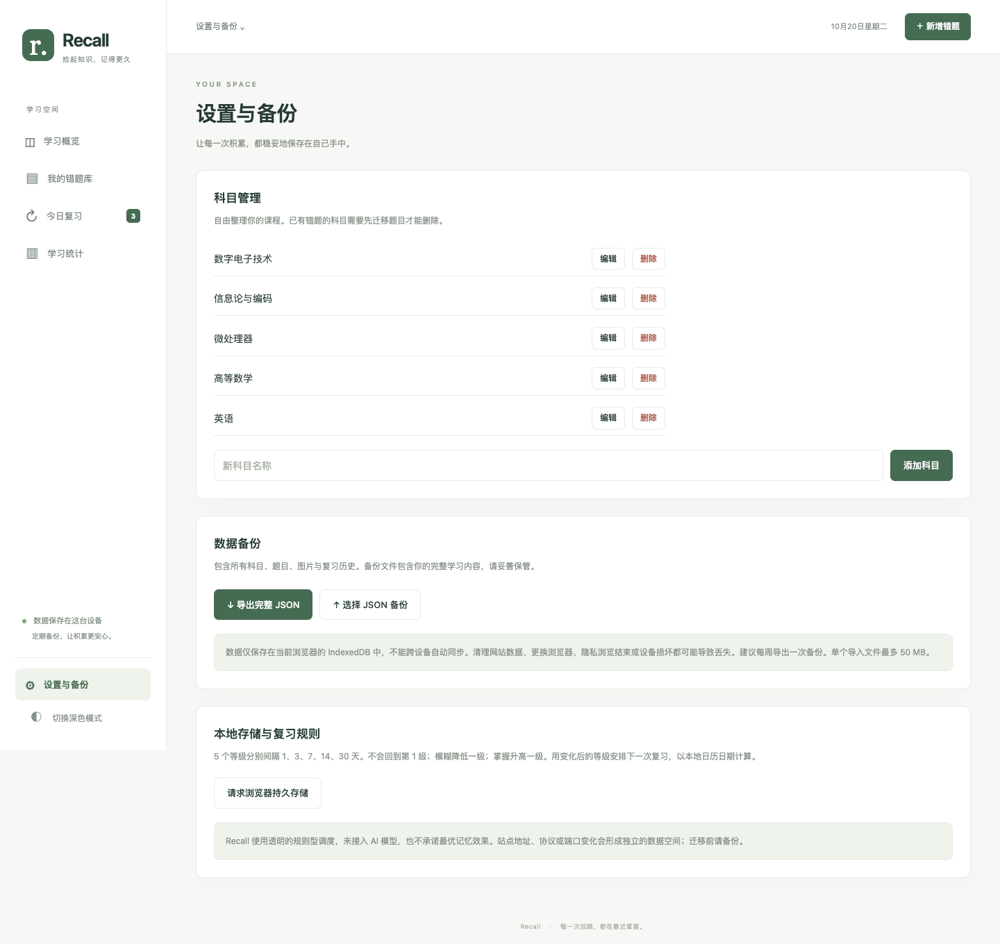
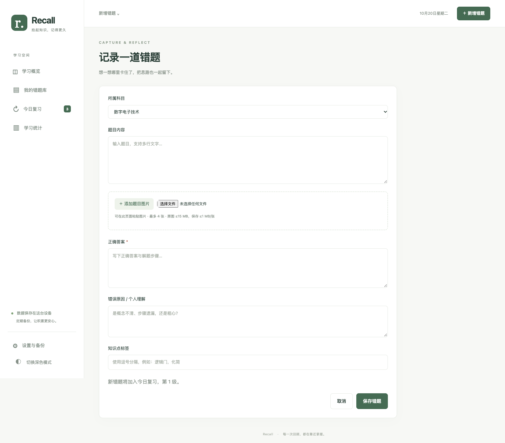
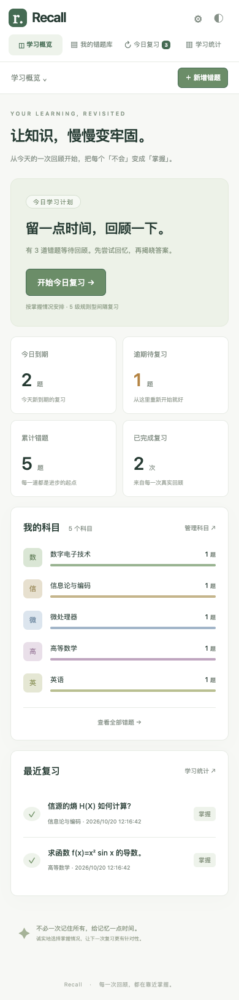
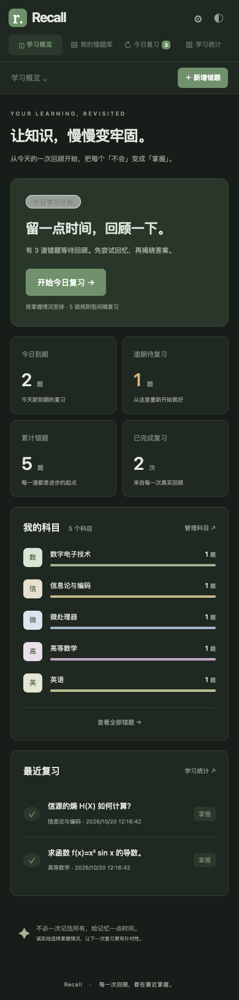

# Recall

**拾起知识，记得更久。** 一个本地优先、无需账户的个人错题与间隔复习网站。

用来集中整理大学课程错题：留下题目、解法和自己的理解，然后按透明的规则每天回顾一点。以实际可用和数据可控为目标，网站运行不需要服务器数据库、付费服务或大模型 API Key。

> **在线体验：[Recall](https://cym7777.github.io/Recall/)** · **源码：[cym7777/Recall](https://github.com/cym7777/Recall)**
> 已通过 GitHub Pages 免费部署。学习数据保存在用户当前浏览器中，不上传到仓库，**不会自动跨设备同步**。

**29 项测试及检查通过：9 项模型测试 + 20 项浏览器检查。** 覆盖错题增删改查、图片持久化、五级调度、并发去重、备份恢复、关闭浏览器后重启和响应式页面。详细范围及未验证事项见 [测试报告](docs/TESTING.md)。

发布后已在正式地址完成全部 20 项浏览器检查，页面无未捕获异常；8 个静态资源均返回 200，并与审查后的源码一致。GitHub Actions 的 9 项模型测试与 20 项浏览器检查也已通过。[线上验证记录](docs/ONLINE-VERIFICATION.md)。

## 界面预览

以下截图来自正式 Pages 地址的独立测试浏览器，题目与记录均为虚构测试数据，不代表真实用户学习成果。正式首次打开仅初始化科目，不填入任何错题或复习成绩。



| 错题库                                          | 每日复习                                         |
| ----------------------------------------------- | ------------------------------------------------ |
|  |  |

| 统计                                            | 设置与备份                                           |
| ----------------------------------------------- | ---------------------------------------------------- |
|  |  |



| 手机浅色                                           | 手机深色                                                |
| -------------------------------------------------- | ------------------------------------------------------- |
|  |  |

## 已实现功能

- 科目新建、改名与删除；初始提供数字电子技术、信息论与编码、微处理器、高等数学和英语。有错题的科目禁止直接删除。
- 错题录入、编辑、删除，支持多行题目、答案、错误原因、自定义标签、全文搜索及科目筛选。
- 上传或粘贴 JPG / PNG / WebP，最多 4 张/题，原图最大 15 MB、4000 万像素，自动压缩至最长边 1800 像素内、每张不超过 1 MB，以 Data URL 保存到 IndexedDB。大图缩小时应检查小字清晰度。
- 新题默认今日待复习；先回忆题目，再主动揭晓答案和错误原因。
- 5 级规则型 Leitner 复习；记录每次反馈、前后等级、本地复习日、时间和下次日期。
- 首页显示今日到期、逾期、错题总数、科目分布和最近记录。每日复习入口同时包含逾期题，按最早到期优先。
- 根据真实保存记录显示每日复习次数、科目数量和等级分布；没有数据时显示真实空状态。
- 完整 JSON 导出，包含图片和历史；导入先校验、展示摘要，再确认覆盖。异常导入不会写入数据。
- 浅色 / 深色、响应式布局、键盘焦点和基本无障碍标签。

## 本地运行

需要 Node.js 22 或更新版本。不需要安装依赖即可启动网站：

```sh
npm start
```

打开终端输出的 `http://127.0.0.1:4173`。也可以用 Python：

```sh
python3 -m http.server 4173 --bind 127.0.0.1
```

必须在项目根目录启动，不要直接双击 HTML（ES Modules 需要 HTTP）。Node 服务器只监听本机；需要其他设备访问时可用受信任的静态服务器。

### 测试

```sh
npm install
npx playwright install chromium
npm test
# 另一个终端保持 npm start 运行
npm run test:browser
```

也支持 pnpm，锁文件为 `pnpm-lock.yaml`：`pnpm install --frozen-lockfile`。Playwright 与 Prettier 均仅为开发依赖，运行网站没有第三方依赖和 CDN 请求。

测试自动创建独立临时浏览器环境，不连接真实个人数据库。浏览器测试会重新生成虚构数据截图。可设置 `RECALL_URL` 指向本地测试服务器；`RECALL_BROWSER` 用于指定测试浏览器可执行文件；`RECALL_PLAYWRIGHT_PATH` 是开发环境可选的模块入口路径；`RECALL_PROXY` 可指定已有的浏览器测试代理。

详见 [测试结果](docs/TESTING.md)。源码格式化：`npm run format`。

## 复习算法

| 当前反馈 | 等级变化            |
| -------- | ------------------- |
| 不会     | 回到 1 级           |
| 模糊     | 降低一级，最低 1 级 |
| 掌握     | 升高一级，最高 5 级 |

| 变化后的等级 | 下次复习间隔 |
| ------------ | ------------ |
| 1            | 1 天         |
| 2            | 3 天         |
| 3            | 7 天         |
| 4            | 14 天        |
| 5            | 30 天        |

新增题目为 1 级且当天到期。例如，10 月 20 日首次选择「掌握」，变为 2 级，下次是 10 月 23 日。使用**反馈后的等级**计算日期；按提交时的本地日历天计算，避免直接增加固定毫秒数造成夏令时问题。更换时区后，待复习依据设备当前本地日期，已有历史的复习日保持原样。

规则用于安排回顾，不接入 AI 模型，不宣称符合最优记忆规律或用等级证明实际掌握。

## 数据可靠性与隐私

- 科目、错题和历史位于当前站点来源的 IndexedDB；刷新、正常关闭浏览器后仍保存。
- 题目和复习历史同一事务写入；失败整体回滚。使用题目 ID 与修订版本标识复习，同一提交重复点击或多标签页并发只记录一次。
- 编辑使用修订版本检查，旧页面不会静默覆盖其他页面的更新。
- 备份从一个只读事务获取一致快照。导入检查版本、类型、日期、关联关系、重复 ID、等级与调度一致性，并解码验证图片；全部通过后单事务整体替换。
- 导入替换、删除错题和删除科目都要求明确确认。删除错题同时删除该题历史；统计是当前留存数据的累计，不是不可变的终身总数。
- 不上传数据，无遥测、账户和外部字体。主题偏好单独保存在 localStorage。

**IndexedDB 不等于备份。** 清理站点数据、隐私浏览结束、设备损坏或浏览器回收存储仍可能丢失。建议每周导出，也可在设置请求浏览器持久存储；浏览器可能拒绝。导出的文件包含完整个人学习内容，请自行妥善保管。

导入文件最多 50 MB、200 科目、10,000 题、100,000 次复习。超过这些校验范围的备份不支持直接恢复；大量图片接近此范围时应提前规划归档。暂不支持备份合并、加密、跨设备同步、云账户、OCR 或 AI 问答。不同浏览器、站点域名、协议或端口是独立数据空间；切换使用地址前先导出、再导入。

## 技术栈与目录

原生 HTML、CSS、JavaScript ES Modules、IndexedDB、Git 和 GitHub Pages。图表用轻量 HTML/CSS 实现，避免引入图表框架。

```text
index.html               应用入口与布局
src/app.js               页面、交互、导航
src/model.js             日期、搜索、规则、错题校验
src/db.js                IndexedDB 事务和并发保护
src/images.js            图片压缩
src/backup.js            备份格式与严格校验
src/style.css            响应式、浅深色主题
scripts/serve.mjs         零依赖本地 HTTP 服务
 tests/                  模型与浏览器回归
 docs/                   架构、测试、截图
.github/workflows/       检查与手动部署
```

## GitHub Pages 部署

公开仓库、首次推送及免费 Pages 部署已获项目所有者批准。以下为项目部署配置：

1. 在 `cym7777` 账号创建公开仓库 `Recall`，将本项目作为独立仓库推送到 `main`，避免包含备份、个人数据、密钥及其他项目。
2. 仓库 Settings → Pages → Source 选择 **GitHub Actions**。
3. Actions 中手动运行 **Deploy Recall to GitHub Pages**。部署工作流仅支持手动触发，不会因为提交代码自动发布。
4. 正式站点为 **[https://cym7777.github.io/Recall/](https://cym7777.github.io/Recall/)**，已实际部署并验证。后续更新通过同一工作流手动部署。

所有资源使用相对路径，支持 `/Recall/` 子路径。GitHub Pages 只托管静态文件，每位访问者的数据独立保存在自己的浏览器中。

## 开发与交付实践

需求分为数据与录入、复习、统计与备份、测试与文档四个阶段，每阶段测试通过后进入下一阶段。AI 辅助完成实现、测试与文档；测试结果只报告实际执行情况，发布由项目所有者决定。设计取舍见 [架构说明](docs/ARCHITECTURE.md)。

MIT License。
